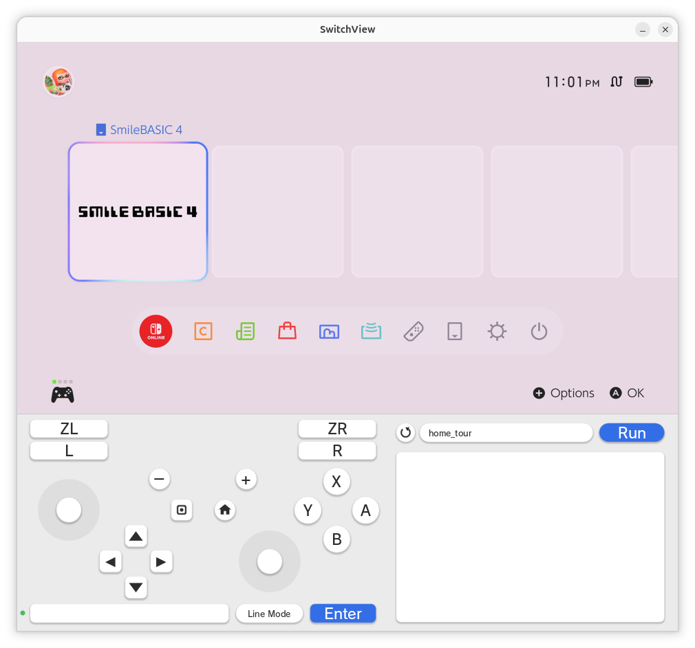

# SwitchView

A low-latency command center for the Nintendo Switch 2 on Linux and macOS.

SwitchView shows the console's screen and sound from a capture card, and puts
a clickable Pro Controller, a keyboard, a mouse and a Lua scripting panel right
underneath it. A Raspberry Pi Pico 2 W, plugged into the dock, presents itself
to the console as a wired Pro Controller, a USB keyboard and a USB mouse; the
app drives it over Wi-Fi.



```
 capture card ──HDMI── Switch 2 dock ──USB── Pico 2 W
      │                                          ▲
     USB                                    UDP over Wi-Fi
      ▼                                          │
 ┌─────────────────────────── SwitchView ───────┴──────┐
 │  video + audio  │  controller · keyboard │  scripts │
 └─────────────────────────────────────────────────────┘
```

## Features

- **Fast capture.** Raw NV12/YUYV frames straight from V4L2, always the newest
  frame, colour conversion on the GPU, no vsync by default. Audio is read from
  ALSA in 1 ms periods with a bounded output queue (~20 ms max).
- **Pro Controller panel.** Click to hold, right-click to latch. Every button
  has a keyboard shortcut (hover a button for a second to see it), and a gamepad
  plugged into the PC is forwarded 1:1.
- **Keyboard.** Type a line and press Enter, or switch to *Live Typing* and
  every key goes straight to the console. Caps Lock on the PC is sent too.
- **Mouse.** Click the video to hand your mouse to the console (for software
  with USB mouse support); Esc gives it back.
- **Scripting.** Lua scripts that press buttons, type text and read the screen
  with OCR (Tesseract). See [Scripting](#scripting).
- **Mute** button over the video, fixed 16:9 window, F11 for full-screen video.

## Hardware

| Part | Notes |
|---|---|
| Linux PC | Tested on Ubuntu with an AMD GPU (OpenGL renderer via SDL2). |
| USB capture card | Developed with an Elgato 4K S; any V4L2/UVC device offering NV12 or YUYV should work. |
| Raspberry Pi Pico 2 W | Plugs into a USB port on the Switch 2 dock. |

Why a Pico? A normal PC's USB ports can only act as hosts; to appear to the
console as a controller something has to be a USB *device*. The Pico's RP2350
can, and the PC does all the thinking.

## Building

### App (Linux)

```sh
sudo apt install build-essential pkg-config libsdl2-dev libsdl2-ttf-dev \
                 libasound2-dev libtesseract-dev tesseract-ocr-eng liblua5.4-dev
make            # builds app/switchview
make run
```

Your user needs access to the capture device (`/dev/video0`, usually the
`video` group) and the capture card's ALSA device.

### App (macOS)

See [MACOS.md](MACOS.md) for Homebrew dependencies, device selection, permissions, and capture validation. The Mac backend uses AVFoundation video and SDL/CoreAudio audio.

### Firmware

Requires the [Raspberry Pi Pico SDK](https://github.com/raspberrypi/pico-sdk),
`cmake`, `ninja` and the ARM GCC toolchain.

```sh
cp firmware/secrets.cmake.example firmware/secrets.cmake   # Wi-Fi + static IP
make firmware PICO_SDK_PATH=/path/to/pico-sdk
```

Hold **BOOTSEL** while plugging the Pico into the PC, then `make flash` copies
the UF2 to the RP2350 drive. Plug the Pico into the dock; it joins Wi-Fi in a
few seconds and the dot left of the text box turns green.

`USB_LAYOUT` picks what the Pico presents: `1` (default) Pro Controller +
keyboard + mouse, `0` controller only, `2` keyboard only.

## Using it

```
./app/switchview [-H pico-ip] [-d /dev/videoN] [-a alsa-device] [-v] [-f] [-n] [-V]
```

| Option | |
|---|---|
| `-H HOST` | Pico address (Linux default `192.168.4.60`; macOS default `none`; must match `SV_PICO_IP` when enabled) |
| `-d DEV` / `-a PCM` | Capture video device / audio input (Linux ALSA; macOS SDL index or name) |
| `-s WxH`, `-r FPS`, `-p nv12\|yuyv` | Capture mode |
| `-v` | Enable vsync (no tearing, up to one frame more latency) |
| `-m SCALE` | Mouse sensitivity sent to the console |
| `-f`, `-n`, `-V` | Start full screen, no audio, print stats |

| Key | Control |
|---|---|
| WASD / arrows | Left / right stick |
| T F G H | D-pad |
| I J K L | X Y B A |
| Q / E, 1 / 3 | L / R, ZL / ZR |
| Z / C | L3 / R3 |
| - / = | Minus / Plus |
| P / M | Home / Capture |
| Enter | Focus the text box (Esc returns to the pad) |
| F11, Ctrl+Q | Full-screen video, quit |

## Scripting

Scripts are Lua files in `scripts/`. Pick one with the name pill (the round
button rescans the folder) and press **Run**; **Stop** ends it at once and
releases every input. Scripts share the controller and keyboard with the panel.

```lua
rule("home", "options", "ok")          -- label a screen by the words on it

tap("HOME")
if wait("home", 10) then               -- block until OCR sees that screen
  dpad("right", 0.1)
  log("on HOME:", screen())
end
```

| Function | |
|---|---|
| `tap(btn..., [hold])` | Press and release (`"A"`, `"ZL"`, `"HOME"`, `"PLUS"`, ...) |
| `press(btn...)`, `release([btn...])` | Hold / let go |
| `dpad(dir, [secs])` | `"up"`, `"downleft"`, ... `"center"` |
| `stick("l"\|"r", x, y, [secs])` | x, y in -1..1, y up |
| `type(text)` | Type on the USB keyboard (`\n` = Enter) |
| `key(name)` | `"capslock"`, `"enter"`, `"esc"`, `"backspace"`, `"tab"`, arrows |
| `capslock()` | Console's Caps Lock state (`nil` if not reported yet) |
| `text()` | OCR text of the current screen (lower-case) |
| `rule(label, words...)`, `rules{}` | Screen labels; every word must appear |
| `screen()` | Label of the current screen, or `"unknown"` |
| `wait(labels, [timeout])` | Wait for a label; returns it or `nil` |
| `find(word, [timeout])` | Is the word on screen? |
| `region(x, y, w, h)` | Limit OCR to part of the frame (0..1); `region()` resets |
| `sleep(secs)`, `log(...)` | |

OCR only runs while a script is running.

`scripts/smilebasic_runner.lua` is a fuller example: it stops any leftover copy
of the NS2 host in `third_party/ns2jb` (Node 22+; that folder is local-only and
not part of this repository — set `NS2_DIR` if yours lives elsewhere), starts a
fresh one, reads the `V=START(...)` line it writes, walks the console to
SmileBASIC 4's Direct
mode, types `LOAD "TXT:NS2"`, `RUN` and `REMOVE NSR,&H60000000,&H3FFFFFFF`,
sends START, and reports the verification result.  The host's output
(`1/4` … `4/4`) is forwarded into the script log, and the script waits until
the host reports — there is no timeout; Stop ends it.  The host is stopped
again if the run bails out.  The console-facing address is reused from the
previous run (set `NS2_HOST` to override it); the NS2 program must already be
saved in slot 0.  Run folders and the host log go to
`$XDG_STATE_HOME/switchview/ns2`.

## Repository layout

| Path | |
|---|---|
| `app/` | SDL2 app: capture, panel UI, Pico link, OCR, Lua runner |
| `firmware/` | Pico 2 W firmware (TinyUSB composite device, lwIP UDP) |
| `proto/switchview_proto.h` | Wire protocol shared by the app and the firmware |
| `scripts/` | Lua scripts |
| `third_party/ns2jb/` | Local-only NS2 host folder (git-ignored, not distributed) |
| `tools/pico_ctl.py` | Command-line client for scripted taps and text |

## Fonts

The panel uses Noto Sans / DejaVu Sans from the system. To use another face,
put it at `app/fonts/NintendoNTLG-DB.ttf` (the folder is git-ignored); it is
picked up automatically.

## Credits

- Pro Controller USB emulation is derived from
  [retro-pico-switch](https://github.com/DavidPagels/retro-pico-switch) by
  David Pagels (MIT).
- [TinyUSB](https://github.com/hathach/tinyusb) by Ha Thach and contributors.
- [Raspberry Pi Pico SDK](https://github.com/raspberrypi/pico-sdk),
  [lwIP](https://savannah.nongnu.org/projects/lwip/), CYW43 driver.
- [SDL2](https://www.libsdl.org/) and SDL2_ttf, [ALSA](https://www.alsa-project.org/),
  [Tesseract OCR](https://github.com/tesseract-ocr/tesseract),
  [Lua](https://www.lua.org/).
- Also informed by
  [SwitchControllerPico](https://github.com/sorasen2020/SwitchControllerPico)
  and [GP2040-CE](https://github.com/OpenStickCommunity/GP2040-CE).

See [THIRD_PARTY_NOTICES.md](THIRD_PARTY_NOTICES.md) for license texts.

## Disclaimer

SwitchView is an independent project and is not affiliated with, endorsed by
or sponsored by Nintendo. "Nintendo Switch" and "Pro Controller" are
trademarks of Nintendo. The firmware identifies itself to the console with
Pro Controller USB IDs for compatibility. Use at your own risk.

## License

MIT © RavensClawX. See [LICENSE](LICENSE).

The NS2 host is not distributed with this project: `third_party/` is
git-ignored, local-only, and not covered by this project's MIT license.
